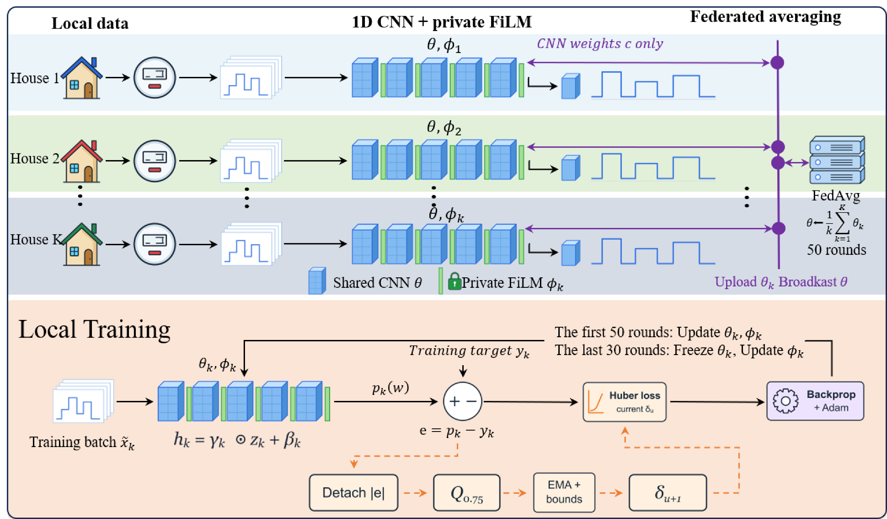

# Private FiLM with Adaptive Huber for Federated NILM

A federated non-intrusive load monitoring pipeline with a shared 1D CNN, household-private FiLM layers, and a residual-adaptive Huber loss. This repository implements configuration **F**: 50 federated rounds followed by 30 local passes that update only FiLM.



[Method figure (PDF)](figures/figure1.pdf) | [Method details](docs/METHOD.md) | [Data and references](docs/DATA_SOURCES.md) | [Output formats](docs/OUTPUTS.md)

## Installation

Use Python 3.8 or later and install a CUDA-compatible PyTorch build for GPU training. The original dependency versions are listed in [requirements-reproduction.txt](requirements-reproduction.txt).

```bash
python -m pip install -e .
python -m nilm_f --help
```

## Data

The prepared REDD and REFIT household CSVs are included under `data/raw/`. They are the input files used by this pipeline, obtained from the [Lightweight-Federated-NILM project](https://github.com/hkuedl/Lightweight-Federated-NILM/tree/main/dataset).

```text
data/raw/
  REDD/
    House_1.csv
    ...
  REFIT/
    CLEAN_House1.csv
    ...
```

The snapshot contains 26 CSV files covering nine dataset-appliance tasks and 94 household-appliance combinations. File hashes, column mappings, and participating households are specified in [configs/data_scope.json](configs/data_scope.json). The loader verifies the files against this manifest.

| Dataset | Supported appliances | Household-appliance combinations |
|---|---|---:|
| REDD | `Fridge`, `DishWasher`, `Microwave`, `Washer` | 18 |
| REFIT | `Fridge`, `DishWasher`, `WashingMachine`, `Microwave`, `Kettle` | 76 |

These prepared CSVs are distinct from the original dataset distributions. See [data/README.md](data/README.md) for the input format and [DATA_SOURCES.md](docs/DATA_SOURCES.md) for references and attribution.

## Train and evaluate

The following commands run REDD Fridge. Preparation writes the split and normalization metadata without training:

```bash
python -m nilm_f prepare --data-root data/raw --dataset REDD --appliance Fridge --output-dir runs/REDD/Fridge/prepared
```

Run development on the internal training split, then train a new model on the full training portion:

```bash
python -m nilm_f train --data-root data/raw --dataset REDD --appliance Fridge --phase development --output-dir runs/REDD/Fridge/development --device cuda
python -m nilm_f train --data-root data/raw --dataset REDD --appliance Fridge --phase formal --output-dir runs/REDD/Fridge/formal --device cuda
```

Evaluate the formal checkpoint on the held-out test portion:

```bash
python -m nilm_f evaluate --checkpoint runs/REDD/Fridge/formal/latest.pt --data-root data/raw --output-dir runs/REDD/Fridge/formal/evaluation --device cuda
```

Add `--save-predictions` to export household predictions, targets, and aggregate power. Add `--resume` to a training command to continue from its last complete checkpoint using the same configuration and data.

To run all nine tasks:

```bash
python -m nilm_f run-all --data-root data/raw --output-root runs --device cuda
```

This runs development and formal training separately. Use `--skip-development` for formal training only. An optional `--smoke` flag runs a small subset with two federated rounds and one local adaptation pass; it changes the data and training budget.

## Training protocol

- Seed: 1; batch size: 64; optimizer: Adam; learning rate: `3e-4`.
- Backbone: five 1D convolutional blocks, average pooling, and a dense prediction head; input and output length: 576.
- Data split: chronological 80% training and 20% testing, with an internal validation suffix during development.
- Normalization: fitted only on the current training portion, before constructing valid windows.
- Federated stage: 50 rounds, one local pass per round, equal-household averaging of shared CNN weights.
- Local adaptation: 30 passes with the CNN frozen and FiLM trainable.
- Private state: FiLM parameters, Huber thresholds, and optimizer states remain local.
- Training memory: automatic mixed precision and activation checkpointing on CUDA.

Evaluation uses future data from the participating households. Predictions are converted to watts and clipped at zero, without learned calibration. MAE and activation F1 are computed per household and averaged equally within each task; activation is defined as power strictly greater than 50 W.

## Repository layout

```text
configs/          Fixed training settings and data manifest
data/raw/         Prepared REDD and REFIT CSV files
docs/             Method, data references, and output formats
figures/          Method overview
src/nilm_f/       Preprocessing, model, loss, training, and evaluation
```

Training creates checkpoints, logs, and predictions under the selected output directory. Generated run files and experimental results are not included in the repository.

## References

Please cite the REDD and REFIT dataset papers and acknowledge the prepared-data source. Complete references and BibTeX entries are provided in [DATA_SOURCES.md](docs/DATA_SOURCES.md). Data and third-party notices are listed in [THIRD_PARTY_NOTICES.md](THIRD_PARTY_NOTICES.md).
